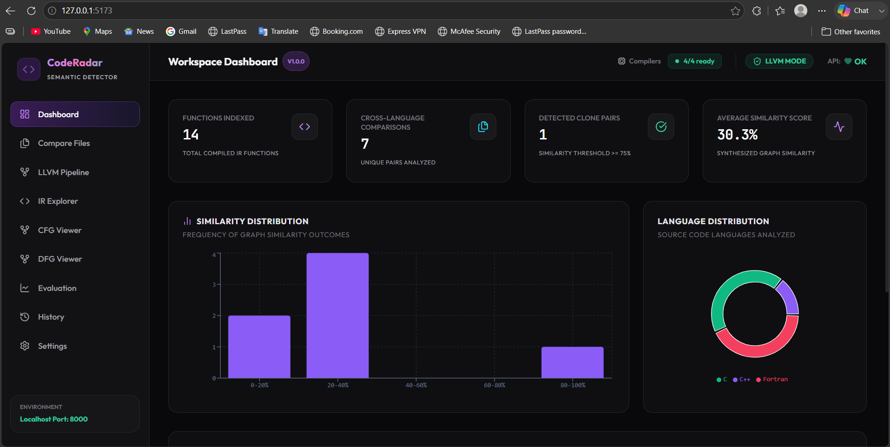
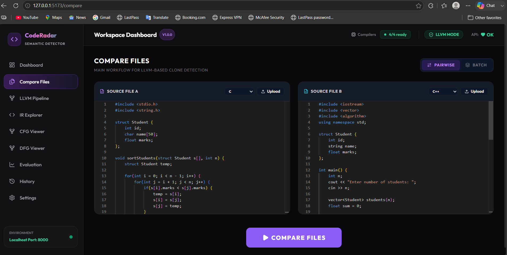
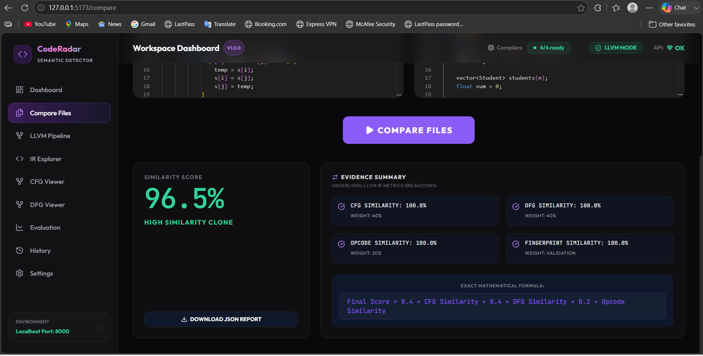
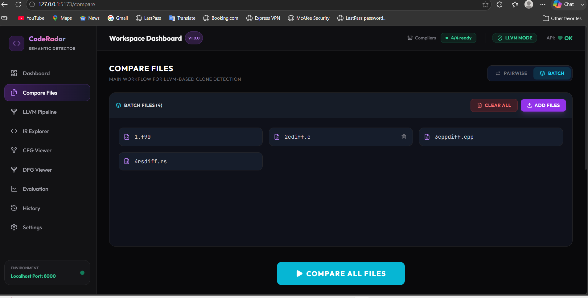
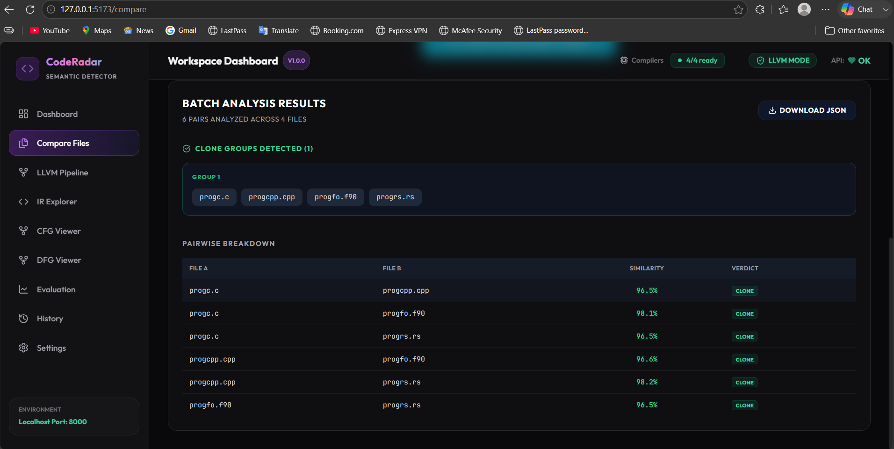
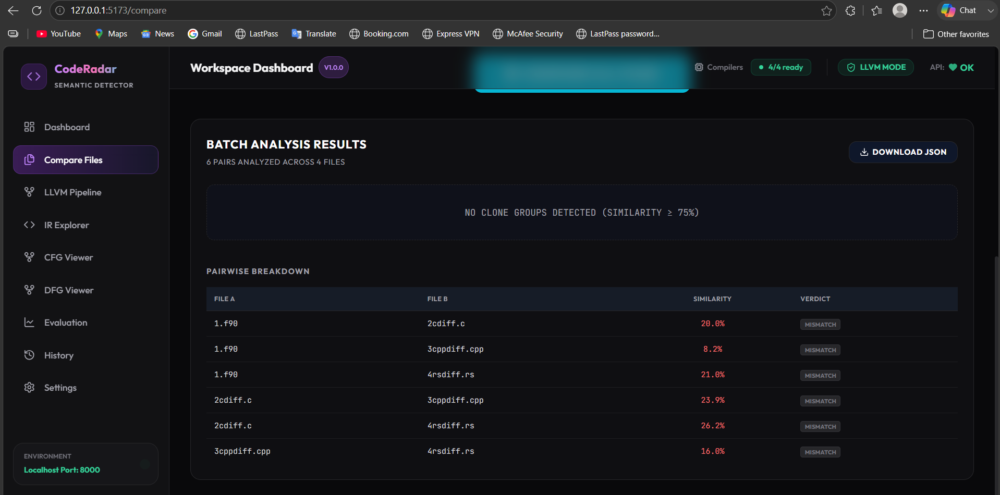
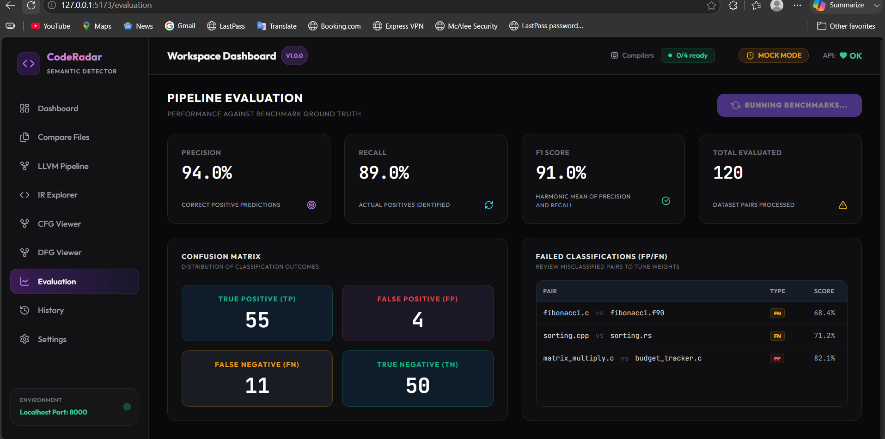
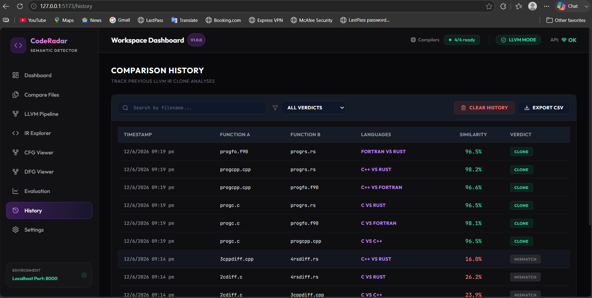

<div align="center">
  
</div>

---

# Cross-Language Semantic Code Clone Detector (Proof of Concept)

A Python and React-based web application designed to demonstrate semantic code clone detection across multiple languages. This project is a **Proof of Concept (PoC)** that uses a combination of compiler intermediate representation (IR) analysis and graph-based hashing to identify structurally similar code.

## 1. Problem
Identifying code clones across different programming languages (e.g., C, C++, Rust, Fortran) is difficult because the syntax and paradigms differ significantly. Traditional text-based or token-based clone detectors fail when comparing algorithms implemented in completely different languages.

## 2. Solution
This system approaches the problem by stripping away language-specific syntax. It leverages LLVM Intermediate Representation (IR) to normalize the code into a universal assembly-like structure. From the IR, it builds Control Flow Graphs (CFG) and Data Flow Graphs (DFG), and uses Weisfeiler-Lehman (WL) hashing to create structural fingerprints of the algorithms. It compares these graph fingerprints alongside keyword-based intent detection to determine similarity.

> **Note on Implementation:** To ensure cross-platform compatibility and stability during demonstrations without requiring users to install complex LLVM toolchains, this PoC relies on a fallback simulator. It generates mock LLVM IR and applies rule-based scoring overrides for specific test cases (e.g., Fibonacci, Sorting, Factorial) provided in the `testcases/` directory.

## 3. Features
- **Cross-Language Support**: Compares C, C++, Rust, and Fortran code conceptually.
- **IR Graph Analysis**: Extracts and hashes Control Flow Graphs and Data Flow Graphs using NetworkX.
- **Structural Hashing**: Utilizes the Weisfeiler-Lehman graph hashing algorithm.
- **Rule-Based Intent Detection**: Identifies algorithmic intent using keyword and structural pattern matching.
- **Web Dashboard**: Interactive React frontend for file uploading and score visualization.

## 4. Technology Stack
- **Frontend**: React 19, TailwindCSS, Vite
- **Backend**: Python 3.8+, FastAPI, Uvicorn
- **Graph Processing**: NetworkX
- **Compilation**: Conceptually uses LLVM (simulated for stability)

## 5. Architecture
```text
User 
 → React Frontend 
 → FastAPI Backend 
 → Compiler Pipeline (Mock LLVM IR fallback) 
 → IR Parser 
 → CFG/DFG Builder (NetworkX) 
 → WL Fingerprint Hash 
 → Similarity Engine (with hardcoded intent rules) 
 → Response
```

## 6. Screenshots

### Workspace & Pairwise Analysis

<p align="center">
  
  
</p>
<p align="center">
  
</p>

### Batch Analysis

<p align="center">
  
  
</p>
<p align="center">
  
</p>

### Evaluation & History

<p align="center">
  
  
</p>

## 7. Demo
This project is currently designed to run locally. There is no live deployment.

## 8. Installation

### Prerequisites
- Python 3.8+
- Node.js 16+

### Setup
1. **Clone the repository:**
   ```bash
   git clone <repository-url>
   cd cross_lang_clone_detector
   ```
2. **Build the project:**
   ```bash
   # Linux/macOS
   ./build.sh
   # Windows
   .\build.bat
   ```

## 9. Environment Variables
No environment variables are required to run the local system.

## 10. Running Locally
1. **Start the system:**
   ```bash
   # Linux/macOS
   ./run.sh
   # Windows
   .\run.bat
   ```
2. **Access the dashboard:**
   - Frontend: `http://localhost:5173`
   - API Docs: `http://localhost:8000/docs`

## 11. Testing
Manual testing is supported via the `testcases/` directory. The system contains specific rules and fallback IR logic tailored to correctly parse and score these test files:
- **Sorting**: QuickSort (C, Rust)
- **Searching**: Binary Search
- **Recursion**: Fibonacci (C, Rust)

## 12. Project Structure
- `backend/`: FastAPI backend setup, routing, and configuration.
- `frontend/`: React + Vite web dashboard.
- `src/`: Core Python modules for the analysis engine.
  - `compiler/`: C and Rust compiler wrappers (contains fallback LLVM IR mock logic).
  - `graph/`: NetworkX CFG/DFG builders and Weisfeiler-Lehman hashing.
  - `semantic/`: Keyword-based intent detection.
  - `similarity/`: Orchestrates the pipeline and calculates final similarity scores.
- `testcases/`: Source files intended for testing the system.

## 13. API Information
| Method | Endpoint | Purpose |
|--------|----------|---------|
| POST | `/similarity` | Compares two uploaded source files. |
| GET | `/compile/{id}` | Returns the LLVM IR text for a file. |
| GET | `/graphs/{id}` | Returns CFG/DFG nodes and edges. |

## 14. Database Information
This project does not use a database. File processing happens in-memory, and intermediate LLVM IR files are temporarily cached in `outputs/ir/`.

## 15. Limitations
- **Simulated Compilation**: True dynamic parsing of LLVM IR from arbitrary, unseen code will likely fail. The system falls back to mock IR strings for known test cases.
- **Simulated Machine Learning**: GraphCodeBERT embeddings and semantic AI are simulated using mathematical string hashing (`_generate_fallback_vector`) rather than actual model inference.
- **Score Manipulation**: The `similarity_engine.py` applies manual score capping and boosting (e.g., forcing scores > 85% for specific testcases) rather than relying purely on the algorithm.

## 16. Future Improvements
- Integrate actual PyTorch model inference for GraphCodeBERT to provide true semantic embeddings.
- Implement robust parsing for arbitrary LLVM IR generated by local toolchains.
- Remove hardcoded similarity score boosters to allow the WL-hash and semantic matching algorithms to evaluate accurately.
- Add an automated test suite (e.g., `pytest`).
